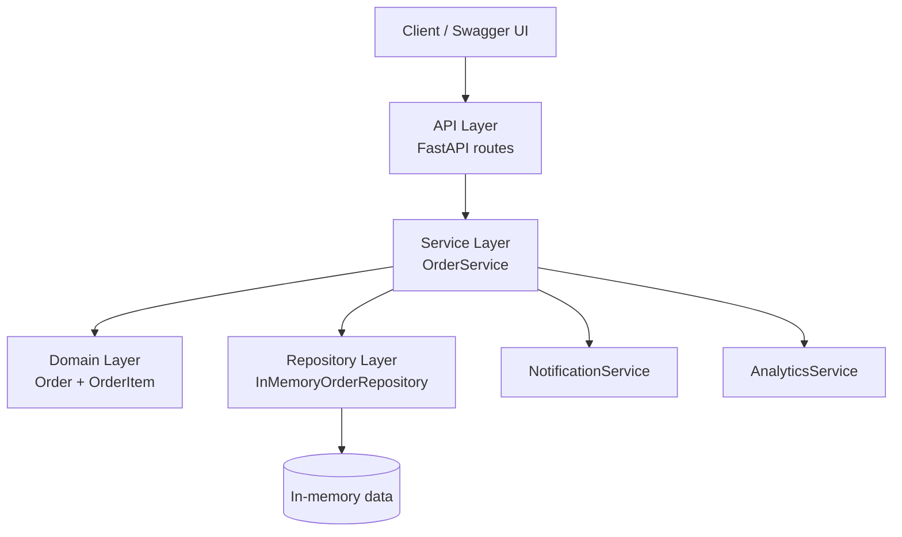

# Layered Architecture

This implementation solves the common [Order Management domain](../../docs/domain.md) using a classic layered architecture.

## Learning objective

Make the dependency flow visible:

```text
HTTP Request
     |
     v
API / Controller
     |
     v
Application Service
     |
     v
Repository
     |
     v
In-memory data
```

The **domain model** contains the business rules, while the service layer coordinates the use cases.

## Architecture



A useful detail for class discussion is that approving an order makes **synchronous calls** to notification and analytics services. Later, the event-driven version will preserve the business behavior while changing this coupling.

## Folder structure

```text
01-layered/
├── app/
│   ├── main.py
│   ├── api/
│   │   └── orders.py
│   ├── domain/
│   │   └── order.py
│   ├── repositories/
│   │   └── order_repository.py
│   └── services/
│       ├── order_service.py
│       └── secondary_services.py
├── tests/
│   └── test_orders.py
└── requirements.txt
```

## Run locally

From this directory:

```bash
python -m venv .venv
source .venv/bin/activate
pip install -r requirements.txt
uvicorn app.main:app --reload
```

On Windows PowerShell, activate the environment with:

```powershell
.venv\Scripts\Activate.ps1
```

Then open:

```text
http://localhost:8000/docs
```

FastAPI provides the Swagger UI automatically.

## Run the tests

```bash
pytest -q
```

## Suggested live demo

1. Create an order.
2. Add one or two items.
3. Retrieve the order.
4. Approve it.
5. Observe the notification and analytics messages in the console.
6. Try to add another item after approval and inspect the `409 Conflict`.
7. Try to approve an empty order.

## What students should notice

### Separation of responsibilities

- **API layer** translates HTTP requests and responses.
- **Service layer** coordinates use cases.
- **Domain layer** protects business rules and state transitions.
- **Repository layer** owns persistence access.

### Dependency direction

The request normally flows from top to bottom:

```text
API -> Service -> Repository
          |
          +-> Domain
          |
          +-> Notification / Analytics
```

### Strengths

- Easy to understand.
- Familiar structure for many business applications.
- Clear separation between HTTP, use-case coordination and persistence.
- Straightforward to test.

### Trade-offs

- The service layer can become a large orchestration layer.
- Cross-cutting changes can touch several layers.
- Synchronous dependencies may increase coupling.
- Layer boundaries do not automatically guarantee domain independence.

## Class change scenario

After the baseline works, introduce this requirement:

> Every approved order must award loyalty points.

Ask students:

1. Where would the new logic live?
2. Which existing class must change?
3. Does `OrderService` need another dependency?
4. How many reasons to change does `OrderService` now have?
5. How might another architectural style handle the same requirement?

Do not treat the answers as proof that one style is universally better. The purpose is to make **modifiability and coupling observable**.
