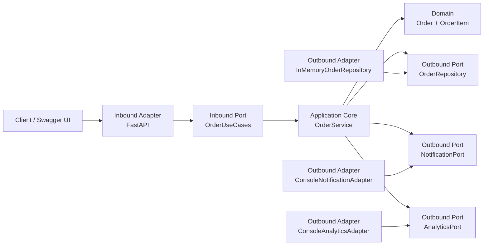

# Hexagonal Architecture (Ports & Adapters)

This implementation solves the **same Order Management problem** and exposes the **same HTTP contract** as the layered example.

The important change is not functionality. It is the **direction of dependencies**.

## Learning objective

In this version, the application core depends on **ports (interfaces)**. External technologies live in **adapters** that depend inward toward those ports.

```text
                    OUTSIDE
                      |
                Inbound Adapter
                  FastAPI / HTTP
                      |
                      v
              +-----------------+
              |   Inbound Port  |
              |  OrderUseCases  |
              +--------+--------+
                       |
                       v
              +-----------------+
              |   Application   |
              |   OrderService  |
              |      Domain     |
              +---+----+----+---+
                  |    |    |
          Outbound Ports / Interfaces
                  |    |    |
          +-------+    |    +----------+
          v            v               v
      Repository   Notification     Analytics
       Adapter       Adapter         Adapter
```

## Architecture



Notice the dependency direction: adapters point **toward** the application contracts.

## Folder structure

```text
02-hexagonal/
├── app/
│   ├── main.py
│   ├── domain/
│   │   └── order.py
│   ├── application/
│   │   ├── ports/
│   │   │   ├── inbound.py
│   │   │   └── outbound.py
│   │   └── services/
│   │       └── order_service.py
│   └── adapters/
│       ├── inbound/
│       │   └── http/
│       │       └── orders.py
│       └── outbound/
│           ├── analytics.py
│           ├── notification.py
│           └── persistence.py
├── tests/
│   ├── test_orders.py
│   └── test_port_substitution.py
├── pyproject.toml
└── requirements.txt
```

## Run locally

```bash
python -m venv .venv
source .venv/bin/activate
pip install -r requirements.txt
uvicorn app.main:app --reload
```

Then open `http://localhost:8000/docs`.

## Run tests

```bash
pytest -q
```

## Suggested comparison with Layered

Open these two files side by side:

```text
01-layered/app/services/order_service.py
02-hexagonal/app/application/services/order_service.py
```

Ask:

1. Which concrete infrastructure classes does each service import?
2. Where are the contracts defined?
3. Which direction do dependencies point?
4. If we replace in-memory persistence with PostgreSQL, what has to change?
5. If notifications move from console output to an external provider, what has to change?

## Live adapter swap

The test `test_port_substitution.py` creates the application service with fake adapters. The application core only knows its ports.

That is the key classroom demonstration of **Dependency Inversion**.

## Change scenario: Loyalty

Use the same requirement as in the layered example:

> Every approved order must award loyalty points.

Discuss adding another outbound port called `LoyaltyPort`, and later compare this with publishing an `OrderApproved` event.

The purpose is not to declare Hexagonal Architecture universally superior. It is to observe how dependency inversion changes **testability, replaceability and modifiability**.
