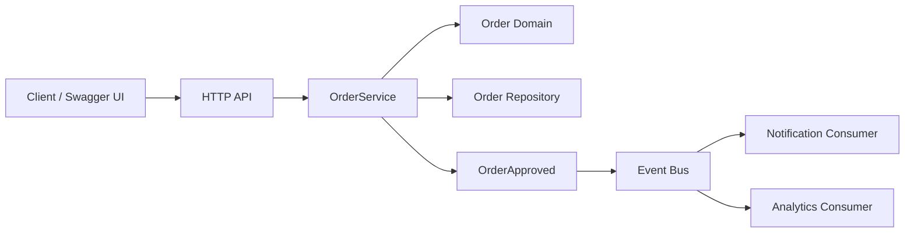

# Event-Driven Architecture

This implementation preserves the same Order Management domain and HTTP contract used by the Layered and Hexagonal examples.

The architectural change happens when an order is approved.

In the previous implementations, the application service explicitly invoked secondary collaborators. Here, the producer publishes a business event:

```text
OrderService
    |
    | publish
    v
OrderApproved
    |
    v
 Event Bus
  /     \
 v       v
Notification
Consumer
          Analytics
          Consumer
```

## Learning objective

Make **temporal and structural decoupling** visible.

The producer knows that an order was approved. It does not need to know all the reactions that exist today or may be added later.

## Important teaching note

This laboratory uses an **in-memory synchronous event bus** on purpose.

Event-driven architecture does not require Kafka, RabbitMQ, or asynchronous infrastructure. Those technologies are possible implementations of event transport, but the core architectural idea is that producers publish events and consumers react independently.

Using an in-memory bus keeps the class focused on architecture rather than infrastructure.

## Architecture



The critical dependency change is:

```text
Before:

OrderService ---> NotificationService
             ---> AnalyticsService

Now:

OrderService ---> EventPublisher ---> OrderApproved

OrderApproved ---> NotificationConsumer
              ---> AnalyticsConsumer
              ---> future consumers...
```

## Folder structure

```text
03-event-driven/
├── app/
│   ├── main.py
│   ├── api/
│   │   └── orders.py
│   ├── domain/
│   │   └── order.py
│   ├── events/
│   │   ├── event_bus.py
│   │   └── order_events.py
│   ├── consumers/
│   │   ├── analytics.py
│   │   └── notification.py
│   ├── repositories/
│   │   └── order_repository.py
│   └── services/
│       └── order_service.py
├── tests/
│   ├── test_orders.py
│   └── test_event_decoupling.py
├── pyproject.toml
└── requirements.txt
```

## Run locally

```bash
python -m venv .venv
source .venv/bin/activate
pip install -r requirements.txt
uvicorn app.main:app --reload
```

Open:

```text
http://localhost:8000/docs
```

## Run tests

```bash
pytest -q
```

## Suggested live demo

1. Create an order.
2. Add an item.
3. Approve the order.
4. Observe two independent reactions in the console:
   - notification;
   - analytics.
5. Open `OrderService.approve_order()`.
6. Ask students to find any reference to Notification or Analytics.

They will not find one.

## The Loyalty change scenario

Use exactly the same requirement introduced in the previous architectures:

> Every approved order must award loyalty points.

In this version, create a new consumer:

```text
OrderApproved
     |
     +--> NotificationConsumer
     +--> AnalyticsConsumer
     +--> LoyaltyConsumer
```

The producer does not change.

The test `test_event_decoupling.py` demonstrates this directly.

## Questions for class

1. What coupling did we remove?
2. What new complexity did we introduce?
3. What happens if one consumer fails?
4. If the bus becomes asynchronous, when is the API response returned?
5. What does eventual consistency mean in this context?
6. How would we prevent processing the same event twice?
7. How would we observe a distributed event flow?

## Trade-offs

### Potential benefits

- Producers do not need to know all consumers.
- New reactions can often be added without changing the producer.
- Consumers can evolve independently.
- Event streams can support asynchronous processing and scaling.

### Costs and risks

- Control flow becomes less obvious.
- Debugging requires tracing across event handlers.
- Delivery semantics matter: at-most-once, at-least-once, exactly-once claims.
- Consumers may need idempotency.
- Asynchronous systems introduce eventual consistency.
- Schema evolution becomes an architectural concern.

The purpose is not to claim that Event-Driven Architecture is universally better. The purpose is to make its coupling model and operational trade-offs observable.
