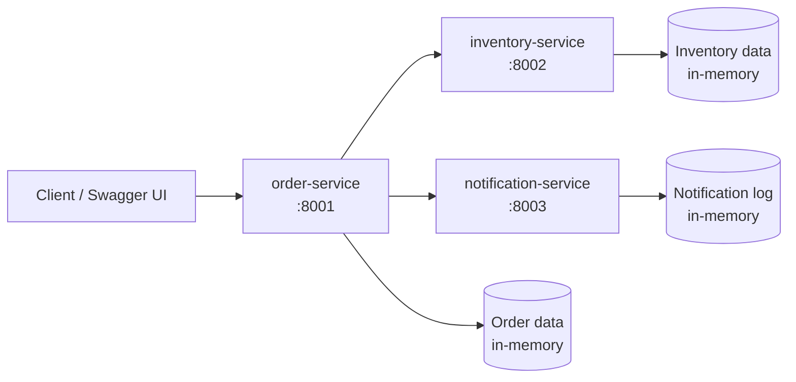

# Microservices Architecture

This implementation preserves the same user-facing Order Management workflow, but changes the **deployment topology**.

Instead of one application process, the system is split into three independently running services:

- **order-service** — owns orders and exposes the public Order API.
- **inventory-service** — owns inventory availability.
- **notification-service** — owns customer notification processing.

## Learning objective

Make the cost and value of a distributed architecture visible in code.

```text
                    Client
                      |
                      v
               +--------------+
               | order-service|
               |    :8001     |
               +------+-------+
                      |
           +----------+-----------+
           |                      |
           v                      v
 +------------------+   +----------------------+
 | inventory-service|   | notification-service |
 |      :8002       |   |        :8003         |
 +------------------+   +----------------------+
```

The external Order API remains intentionally similar to the previous examples.

## Architecture



Each service is a separate FastAPI process and has its own runtime state.

## Service responsibilities

### order-service

Public endpoints:

```text
POST /orders
POST /orders/{id}/items
GET  /orders/{id}
POST /orders/{id}/approve
POST /orders/{id}/cancel
```

Before adding an item, it asks `inventory-service` whether enough stock is available.

When approving an order, it calls `notification-service`.

### inventory-service

Internal endpoint:

```text
GET /inventory/{product_id}?quantity=2
```

It owns stock availability.

### notification-service

Internal endpoint:

```text
POST /notifications/order-approved
```

It records the notification request and writes it to the console.

## Run the complete system

From this directory:

```bash
docker compose up --build
```

Then open:

- Order API: `http://localhost:8001/docs`
- Inventory API: `http://localhost:8002/docs`
- Notification API: `http://localhost:8003/docs`

Stop everything with:

```bash
docker compose down
```

## Suggested live demo

1. Start all three services with Docker Compose.
2. Create an order in the Order Swagger UI.
3. Add product `P001`, quantity `2`.
4. Show the `inventory-service` logs.
5. Approve the order.
6. Show the `notification-service` logs.
7. Stop `notification-service`:
   ```bash
   docker compose stop notification-service
   ```
8. Create and populate another order.
9. Try to approve it.

The client receives a service-unavailable error because a network dependency disappeared.

Now retrieve the order again.

A particularly important observation is possible: the order may already be `APPROVED` even though the notification call failed. The local state change and the remote call were **not one atomic transaction**.

## Why this matters

In a monolith, this code can look conceptually simple:

```text
approve order
notify customer
return success
```

Across service boundaries, each arrow can fail independently:

```text
order-service --network--> notification-service
```

This introduces architectural concerns such as:

- timeouts;
- retries;
- idempotency;
- circuit breakers;
- distributed tracing;
- partial failure;
- eventual consistency;
- sagas / compensating actions;
- service discovery;
- independent deployment;
- observability.

## Data ownership

The example intentionally gives each service its own in-memory data.

No service reaches directly into another service's data store.

That boundary matters more than the fact that this lab uses memory instead of a production database.

## Tests

Unit tests for the public Order API use fake service clients so the business behavior can be exercised without a network.

```bash
pip install -r requirements-dev.txt
pytest -q
```

The GitHub workflow also starts the complete Docker Compose topology and runs a smoke test across the real HTTP service boundaries.

## Comparison with previous styles

### Layered

```text
One process
Controller -> Service -> Repository
```

### Hexagonal

```text
One process
Core -> ports <- adapters
```

### Event-Driven

```text
One process in this lab
Producer -> event bus -> consumers
```

### Microservices

```text
Multiple processes
Service -> network -> service
```

Microservices describe **service boundaries and independent deployment**, not a replacement for internal architecture. A real microservice can itself use Layered, Hexagonal, Event-Driven, or another internal style.

## Questions for class

1. What did we gain by moving Inventory and Notification into separate services?
2. What failures are now possible that did not exist with in-process calls?
3. Who owns each piece of data?
4. Should notification failure make order approval fail?
5. How could an event-driven interaction change that answer?
6. Where would retries live?
7. What must be idempotent?
8. How would we trace one request across all three services?
9. When is the operational cost of microservices justified?

The purpose is not to present microservices as a maturity level or a universally better architecture. The point is to make the **distribution trade-off** concrete.
