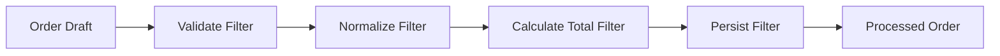

# Pipes & Filters Architecture

This example uses the same **Order Management** domain, but focuses on a different architectural force: **sequential processing**.

That distinction is intentional.

Layered, Hexagonal, Event-Driven and Microservices can all naturally expose the same CRUD-style order workflow. Pipes & Filters is most useful when data moves through a sequence of independent transformations.

Forcing every architectural style onto exactly the same interaction model would hide an important lesson:

> Architectural styles fit some problem shapes better than others.

## Learning objective

Make a processing pipeline visible in code:

```text
Order Draft
    |
    v
+-----------+
| Validate  |
+-----+-----+
      |
      v
+-----------+
| Normalize |
+-----+-----+
      |
      v
+-----------------+
| Calculate Total |
+--------+--------+
         |
         v
+-----------+
| Persist   |
+-----+-----+
      |
      v
Processed Order
```

Each filter:

- receives a processing context;
- performs one focused transformation or validation;
- passes the context to the next filter;
- does not need to know the complete pipeline.

## Architecture



## Folder structure

```text
05-pipes-and-filters/
├── app/
│   ├── main.py
│   ├── models.py
│   ├── pipeline.py
│   ├── repository.py
│   └── filters/
│       ├── validation.py
│       ├── normalization.py
│       ├── totals.py
│       ├── fraud.py
│       └── persistence.py
├── tests/
│   ├── test_api.py
│   └── test_pipeline_extension.py
├── pyproject.toml
└── requirements.txt
```

## Run locally

```bash
python -m venv .venv
source .venv/bin/activate
pip install -r requirements.txt
uvicorn app.main:app --reload
```

Open:

```text
http://localhost:8000/docs
```

## API

Process an order draft:

```http
POST /orders/process
```

Example:

```json
{
  "customer_id": " c001 ",
  "items": [
    {
      "product_id": " p001 ",
      "quantity": 2,
      "unit_price": 25.5
    }
  ]
}
```

The response includes a `trace` field so students can see the order in which filters executed.

## Run tests

```bash
pytest -q
```

## The extension demo

The baseline pipeline is:

```text
Validate
   |
Normalize
   |
CalculateTotal
   |
Persist
```

Now introduce:

> Orders above a configurable amount must go through fraud review.

The existing filters do not change.

A new filter is inserted:

```text
Validate
   |
Normalize
   |
CalculateTotal
   |
FraudDetection   <-- new
   |
Persist
```

The test `test_pipeline_extension.py` demonstrates this.

## Questions for class

1. Which filter owns each responsibility?
2. Does a filter know what comes before or after it?
3. How easy is it to reorder steps?
4. What happens if two filters depend on hidden shared state?
5. Where should errors stop the pipeline?
6. Which filters are pure transformations and which have side effects?
7. Would this style fit an ETL pipeline? A compiler? Image processing? Request validation?
8. Would it be a natural fit for every CRUD application?

## Typical strengths

- Clear processing stages.
- Filters can often be reused.
- Easy to add, remove or reorder stages.
- Natural fit for stream and transformation workloads.
- Individual filters are straightforward to test.

## Trade-offs

- Shared context can become an implicit coupling mechanism.
- Ordering dependencies may become difficult to manage.
- Side effects complicate retries.
- A simple request/response domain may not benefit from a pipeline.
- Debugging requires understanding the whole processing sequence.

The objective is not to rank this style against the others. It is to identify the architectural forces for which it is a natural fit.
