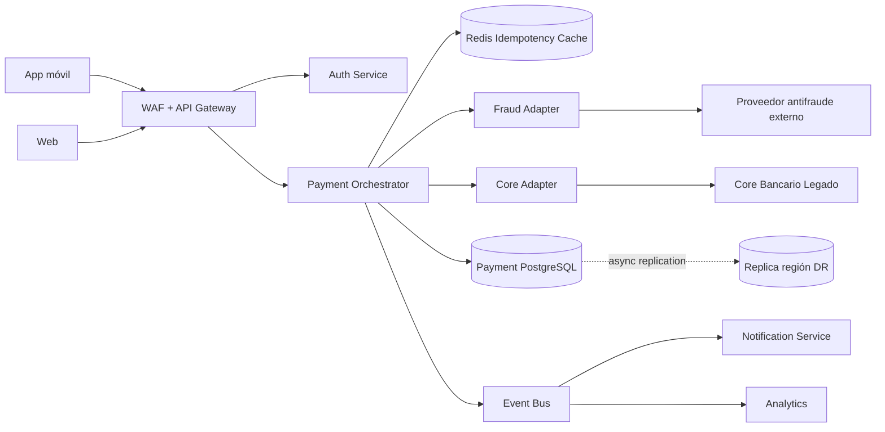

# Caso del alumno — Banco Horizonte: evaluación de arquitectura con QAW + ATAM-lite

> **Caso ficticio para fines académicos.** Ninguna cifra, arquitectura o incidente corresponde a un banco real.

## Objetivo

Evaluar una arquitectura bancaria usando dos técnicas complementarias:

1. **QAW (Quality Attribute Workshop)** para transformar objetivos de negocio y preocupaciones de stakeholders en escenarios de atributos de calidad, priorizados y medibles.
2. **ATAM-lite**, una adaptación académica del Architecture Tradeoff Analysis Method, para analizar cómo decisiones arquitectónicas concretas responden —o no— a esos escenarios, e identificar riesgos, puntos de sensibilidad y trade-offs.

No se busca “aprobar” o “rechazar” la arquitectura. Se busca **razonar sobre sus consecuencias**.

---

# 1. Contexto del banco

Banco Horizonte es un banco minorista ficticio con fuerte crecimiento digital. La gerencia quiere lanzar una nueva plataforma de **Pagos Inmediatos** para transferencias entre cuentas y hacia otros bancos.

El producto debe salir en producción en **seis meses**.

La nueva plataforma convivirá con un core bancario legado que seguirá siendo el sistema de registro contable de cuentas y movimientos.

## Volúmenes esperados

- Tráfico normal: **250 transacciones por segundo (TPS)**.
- Picos recurrentes: **1.200 TPS durante 15 minutos**, especialmente en fechas de pago de nómina.
- 4,5 millones de clientes digitales.
- 75% de las transferencias se originan desde la app móvil.

## Objetivos de negocio

1. Lanzar el nuevo producto en seis meses.
2. Evitar doble débito ante reintentos de clientes o gateways.
3. Ofrecer una experiencia percibida como inmediata.
4. Reducir el impacto de fallas de terceros.
5. Poder cambiar de proveedor antifraude sin rediseñar toda la plataforma.
6. Mantener trazabilidad suficiente para investigación y auditoría.
7. Cumplir objetivos exigentes de continuidad para el flujo crítico de pagos.

---

# 2. Stakeholders

Cada grupo debe asumir al menos cuatro perspectivas.

| Stakeholder | Preocupación principal |
|---|---|
| Líder de Producto Digital | velocidad de salida, experiencia y crecimiento |
| SRE / Operaciones | disponibilidad, recuperación, observabilidad |
| Seguridad / Fraude | prevención de transacciones fraudulentas |
| Cumplimiento / Auditoría | trazabilidad y evidencia |
| Arquitectura / Ingeniería | modificabilidad e integración |
| Dueño del Core Bancario | estabilidad del core legado |
| Servicio al Cliente | consistencia de respuesta ante errores y reintentos |

---

# 3. Comentarios iniciales de stakeholders

Los siguientes comentarios son deliberadamente ambiguos. Parte del ejercicio consiste en convertirlos en escenarios medibles.

1. **Producto:** “La transferencia debe sentirse instantánea.”
2. **Operaciones:** “En quincena no podemos caernos.”
3. **Fraude:** “Una caída del proveedor antifraude no puede abrir una puerta para fraude.”
4. **Servicio al Cliente:** “Un retry nunca puede terminar en doble débito.”
5. **Arquitectura:** “Si cambiamos de proveedor antifraude, no quiero tocar canales ni core.”
6. **Cumplimiento:** “Debemos reconstruir exactamente qué ocurrió con una transferencia.”
7. **Core Bancario:** “No podemos saturar el core legado.”
8. **Gerencia:** “La región principal puede fallar y el negocio debe continuar.”

---

# 4. Arquitectura propuesta

## Vista de alto nivel



## Decisiones arquitectónicas actuales

### A1. Payment Orchestrator

- Servicio stateless.
- Escala horizontalmente.
- Coordina el flujo de pago.
- Hace llamadas síncronas a Fraude y Core Adapter.

### A2. Antifraude

- Toda transferencia se valida mediante un **Fraud Adapter**.
- El adaptador transforma el modelo interno del banco al contrato del proveedor.
- El orquestador recibe una decisión canónica: `ALLOW`, `REVIEW` o `BLOCK`.
- Timeout configurado: **400 ms**.
- Política actual ante timeout: **fail-closed** para todas las transferencias; se responde error temporal y no se continúa al core.

### A3. Idempotencia

- El cliente/gateway envía un `Idempotency-Key`.
- Redis conserva la clave durante 24 horas.
- La base PostgreSQL también tiene una restricción única sobre la clave.
- Si el mismo request se repite, el sistema debe devolver el resultado ya registrado cuando sea posible.

### A4. Core bancario legado

- Se integra mediante `Core Adapter`.
- Capacidad sostenible medida: **700 TPS**.
- Sobre ese nivel, la latencia aumenta rápidamente y aparecen timeouts.
- El core no puede ser reemplazado dentro del horizonte del proyecto.

### A5. Persistencia y DR

- PostgreSQL multi-AZ dentro de la región principal.
- Réplica asíncrona hacia una región secundaria.
- Lag observado de la réplica DR: **15–60 segundos**.
- Región secundaria en modo **warm standby**.
- Última prueba de failover extremo a extremo: **8–12 minutos**.

### A6. Eventos

- Después de confirmar el pago en PostgreSQL, el orquestador publica `PaymentCompleted` en el Event Bus.
- Notification y Analytics consumen ese evento.
- Actualmente **no existe transactional outbox**: la escritura en PostgreSQL y la publicación del evento son dos operaciones separadas.

### A7. Seguridad

- TLS externo y mTLS entre servicios.
- Tokens OIDC para autenticación de clientes.
- Las transferencias de riesgo alto **no pueden bypassar** la evaluación antifraude.
- Los logs de auditoría incluyen `transaction_id`, `customer_id`, timestamp, decisión de fraude y resultado del core.

### A8. Observabilidad

- Trazas distribuidas entre API Gateway, Payment Orchestrator, Fraud Adapter y Core Adapter.
- El core legado no propaga la traza internamente, pero el Core Adapter registra `correlation_id` y código de respuesta.

---

# 5. Objetivos cuantitativos conocidos

Estos objetivos forman parte del caso y deben ser usados como evidencia durante la evaluación.

| Objetivo | Meta |
|---|---|
| Performance pico | 1.200 TPS durante 15 min |
| Latencia end-to-end | p95 ≤ 1,5 s; p99 ≤ 3 s |
| Error rate en pico | < 0,5% |
| Continuidad región | RTO ≤ 5 min |
| Datos de pagos confirmados | RPO = 0 |
| Cambio proveedor antifraude | ≤ 6 semanas |
| Doble débito por retry | 0 casos |
| Reconstrucción de una transacción | ≤ 10 min |

---

# 6. Parte I — QAW

## Propósito

Convertir objetivos de negocio y preocupaciones de stakeholders en **escenarios de atributos de calidad concretos, medibles y priorizados**.

## 6.1 Identifique drivers arquitectónicos

Como grupo, seleccione entre **4 y 6 drivers**.

Ejemplos de categorías posibles:

- disponibilidad;
- performance;
- seguridad;
- modificabilidad;
- resiliencia;
- auditabilidad;
- interoperabilidad;
- escalabilidad.

No basta con escribir “alta disponibilidad”. Deben explicar **por qué es arquitectónicamente relevante**.

## 6.2 Genere escenarios de calidad

Construyan al menos **6 escenarios**.

Cada escenario debe contener las seis partes:

| Parte | Pregunta |
|---|---|
| Fuente | ¿Quién o qué genera el estímulo? |
| Estímulo | ¿Qué ocurre? |
| Ambiente | ¿En qué condición del sistema? |
| Artefacto | ¿Qué parte de la arquitectura recibe el estímulo? |
| Respuesta | ¿Qué debe hacer el sistema? |
| Medida | ¿Cómo sabremos si respondió adecuadamente? |

### Plantilla

**ID:**  
**Atributo de calidad:**  
**Fuente:**  
**Estímulo:**  
**Ambiente:**  
**Artefacto:**  
**Respuesta:**  
**Medida de respuesta:**  
**Business driver relacionado:**  

## 6.3 Priorice

Cada integrante dispone de **3 votos**.

Reglas:

- puede asignar máximo 2 votos al mismo escenario;
- los escenarios con mayor votación pasan a refinamiento;
- en caso de empate, prioricen el que amenace un business driver más crítico.

Seleccionen los **4 escenarios prioritarios**.

## 6.4 Refinamiento

Para cada uno de los cuatro escenarios prioritarios:

1. Verifique que la medida de respuesta sea observable.
2. Elimine palabras vagas como “rápido”, “robusto”, “seguro” o “fácil”.
3. Identifique qué decisión arquitectónica actual podría ayudar o perjudicar el escenario.
4. Escriba una pregunta que le haría al arquitecto.

---

# 7. Parte II — ATAM-lite

> Para fines académicos se usará una versión reducida. No representa la ejecución formal completa de ATAM.

## 7.1 Construya un mini Utility Tree

Use los atributos de calidad prioritarios del QAW.

Ejemplo de estructura:

```text
Utility
├── Availability
│   └── Escenario ...
├── Performance
│   └── Escenario ...
├── Security
│   └── Escenario ...
└── Modifiability
    └── Escenario ...
```

Para cada escenario hoja, asigne:

- **Importancia:** H / M / L
- **Dificultad arquitectónica:** H / M / L

## 7.2 Escenarios mínimos a analizar

Independientemente de la priorización del grupo, el análisis ATAM-lite debe incluir los siguientes cuatro escenarios.

### S1 — Peak performance

Durante una fecha de nómina, clientes generan **1.200 TPS durante 15 minutos**. El sistema debe mantener:

- p95 ≤ 1,5 s;
- p99 ≤ 3 s;
- error rate < 0,5%.

### S2 — Region failure

Durante operación a **900 TPS**, la región principal queda completamente indisponible.

El servicio crítico de pagos debe:

- restablecerse en ≤ 5 minutos;
- no perder pagos ya confirmados;
- no producir doble débito durante la recuperación.

### S3 — Fraud provider replacement

El banco decide cambiar al proveedor antifraude.

El nuevo proveedor debe estar productivo en ≤ 6 semanas y el cambio no debe exigir modificaciones en:

- app móvil;
- web;
- core bancario.

### S4 — Duplicate request

El gateway pierde la respuesta y reenvía **5 veces** la misma transferencia durante 30 segundos usando el mismo `Idempotency-Key`.

Resultado esperado:

- un solo débito;
- un solo `transaction_id`;
- respuesta consistente al cliente;
- resolución del retry en ≤ 2 segundos.

## 7.3 Analice cada escenario

Complete una tabla como esta:

| Campo | Análisis |
|---|---|
| Escenario | |
| Componentes involucrados | |
| Decisiones arquitectónicas relevantes | |
| Evidencia disponible | |
| Riesgo / No-riesgo | |
| Punto de sensibilidad | |
| Trade-off posible | |
| Pregunta abierta | |
| Mitigación recomendada | |

## 7.4 Identifique findings ATAM-lite

El grupo debe producir como mínimo:

- **3 riesgos arquitectónicos**;
- **2 no-riesgos**;
- **2 puntos de sensibilidad**;
- **1 trade-off point**;
- **1 risk theme** que agrupe varios riesgos.

### Definiciones de trabajo

**Riesgo:** una decisión o ausencia de decisión que puede impedir cumplir un atributo de calidad importante.

**No-riesgo:** una decisión que, con la evidencia disponible, soporta adecuadamente un objetivo importante.

**Punto de sensibilidad:** parámetro o decisión cuyo cambio tiene un efecto significativo sobre un atributo de calidad.

**Trade-off point:** decisión que afecta de manera relevante más de un atributo de calidad, potencialmente en direcciones opuestas.

**Risk theme:** patrón que agrupa varios riesgos individuales bajo una causa arquitectónica común.

---

# 8. Entregable del grupo

Preparar una exposición de máximo **5 minutos** con:

1. Top 4 escenarios QAW.
2. Mini Utility Tree.
3. Tres findings más importantes.
4. Un trade-off.
5. Un risk theme.
6. Una recomendación arquitectónica prioritaria.

La recomendación debe responder:

> ¿Qué cambio realizarían primero y qué business driver protege?

No se acepta como respuesta “migrar todo a microservicios”, “usar cloud” o “poner más servidores” sin explicar el mecanismo arquitectónico y el atributo de calidad afectado.

---

# 9. Pregunta final

Respondan individualmente:

> ¿Cuál es la diferencia entre decir “la arquitectura tiene alta disponibilidad” y demostrar que una arquitectura puede satisfacer un escenario concreto de disponibilidad?

---

# Referencias metodológicas

El caso se inspira en los enfoques públicos del Software Engineering Institute (SEI) para QAW y ATAM:

- Quality Attribute Workshop Collection — CMU Software Engineering Institute.
- Quality Attribute Workshops (QAWs), Third Edition — CMU/SEI-2003-TR-016.
- Architecture Tradeoff Analysis Method Collection — CMU Software Engineering Institute.
- ATAM: Method for Architecture Evaluation — CMU/SEI-2000-TR-004.
